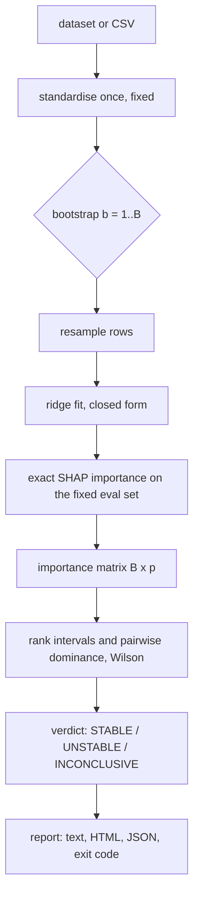
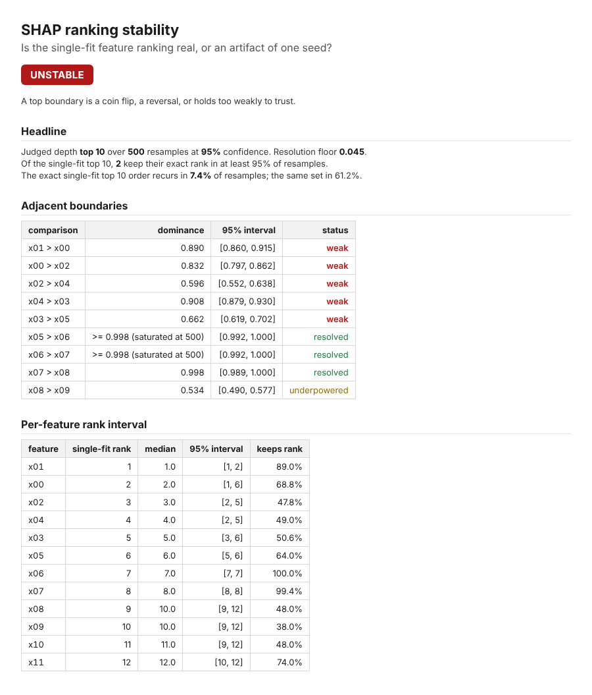

# shap-stability

**Turns a single-fit SHAP feature ranking into a resampling distribution, so each rank is reported as real or as a seed artifact instead of as a fact.**


## The impossibility

A SHAP summary plot is read off one model fit. That fit produces one attribution vector
and therefore one feature ranking, and the ranking has no variance attached to it. So on
its own it cannot answer the question a reader actually has:

1. Is feature A above feature B because it genuinely matters more, or because this one
   sample fell that way?
2. If the ranking says feature X is third, how far would that rank move under a different
   sample of the same size?
3. When two features are near-tied, is the order between them anything but a coin flip?
4. If a comparison is undecided, is that the data refusing to separate them, or just too
   few resamples?

One fit has no model of its own variance, so it cannot separate signal from sampling luck.
This tool refits the model across bootstrap resamples, recomputes exact SHAP importances on
a fixed evaluation set, and supplies the distribution the single fit structurally lacks.

## The uncomfortable numbers

On the bundled dataset, under the shipped policy, the single fit produces a confident
ranking that resampling then contradicts:

- The single fit ranks the features 1 through 12. Across 500 resamples, **only 2 of the
  top 10 keep their exact rank** in at least 95% of resamples.
- The **exact top-10 order recurs in 7.4% of resamples**; the same set in 61.2%.
- The feature `x00`, which the single fit ranks second, has its rank span **ranks 1 to 6
  across** the resamples.
- One boundary (`x08` over `x09`) is a near coin flip the budget cannot resolve: with a
  resolution floor of 0.045 at 500 resamples, settling it would take **about 831
  resamples**.

The verdict is **UNSTABLE**. The point is not that the tool failed; it is that the ranking
a reader would have trusted is not reproducible. The suite is **115 tests** at **100% line
coverage**, and every number in this document is re-measured by `tools/collect_metrics.py`
and verified against this prose by `tools/check_numbers.py` in CI.

## Quickstart

Prerequisites: Python 3.11 or newer. No API keys, no network, no cloud.

```bash
pip install -e .            # the shapstab CLI, numpy only
shapstab                    # the headline verdict on the bundled dataset
shapstab --html report.html --json report.json   # the report and its record

pip install -e ".[dev]"     # ruff and pytest, for the checks
make verify                 # lint, test, then re-measure and check every figure
```

`make verify` runs the linter, the test suite and the receipts, offline, from a fresh
clone. It is the one command this README promises a reviewer.

## What one fit hides, and what the tool reports

The analysis is per boundary, because a ranking is used one comparison at a time. Each
adjacent pair in the single-fit order gets a dominance probability (the share of resamples
in which the higher feature really is more important) and a Wilson interval on it.

| boundary status | meaning | effect on the verdict |
|---|---|---|
| resolved | higher feature wins at least 90% of resamples | keeps it stable |
| weak | wins more than half the time, but below 90% | UNSTABLE: not trustworthy |
| tie | dominance within a small band of 0.5 | UNSTABLE: a coin flip |
| reversed | the lower feature usually wins | UNSTABLE: order likely wrong |
| underpowered | interval still straddles 0.5 | INCONCLUSIVE: needs more resamples |

The distinction between weak and resolved is the heart of it: an order that holds 54% of
the time is significantly above a coin flip and still not something to rely on. See ADR-003.

## The instability comes from the correlation

If the wandering ranks were just noise they would not track the feature correlation. They
do. Sweeping the correlation of a feature cluster, the cluster's mean 95% rank interval
widens **from 1.67 at no correlation to 3.33 at the** tightest setting, while the
independent tail stays flat (experiment 2). Collinearity forces a linear fit to split one
shared effect across the cluster, and the bootstrap decides the split, so the within-cluster
order is a seed artifact by construction.

## More resamples buy resolution, at a known rate

The smallest dominance gap a budget can resolve is one over the square root of the budget.
So the resolution floor falls from **0.141 at 50** resamples to **0.032 at 1000**
(experiment 3). Halving the floor costs four times the resamples. The verdict quotes this
floor next to every inconclusive boundary, so "undecided" always comes with the price of
deciding.

## The calibration: it declines the comparison that cannot be made

Across 300 independently generated datasets with two genuinely equal-importance features,
the single fit names a **winner in 51.7% of** them (95% interval [0.460, 0.573], which
brackets a coin flip). That is the sense in which a single-fit tie is arbitrary
(experiment 4).

The honest boundary sits right next to this result. The bootstrap resamples one dataset's
rows, so it recovers that dataset's realised order, not the across-dataset coin flip:
within a single dataset the bootstrap still orders the tied pair confidently **in 18% of**
cases. The tool measures reproducibility under resampling, which is not the same as
reproducibility across datasets. This is stated plainly in "What this cannot measure" and
in ADR-004, because it is the first thing a careful reader should know.

## The bug the measurement found

The hand-written ridge originally centred the target but not the design matrix, which
quietly assumes the columns already have zero mean. The full standardised data does, but a
bootstrap resample does not: resampling rows gives each column a small non-zero mean, and
those offsets leaked into the coefficients. The symptom was a cross-check failure, the
hand-written fit disagreeing with scikit-learn's `Ridge` at the third decimal (0.9725
against 0.9729) on non-centred input. The fix centres the design matrix per fit, which
matches scikit-learn to 1e-8 and removes a confound: the bootstrap variance now reflects
coefficient instability alone. A regression test pins the invariant by shifting a whole
column by a constant and asserting the coefficients do not move. See the commit
"Fix ridge intercept: centre X per fit, not just y".

## Architecture



The source is kept below so the picture is regenerated by `tools/render_diagrams.py`
rather than trusted to a live renderer.



## Evidence



The screenshot is the real HTML report, captured by `tools/capture_screenshots.py`, which
reads back the computed style of the verdict badge and fails if it is illegible. The demo
below is a replay of captured stdout, paced by each command's measured wall time, recorded
by `tools/record_demo.py`; the manifest at `docs/video/manifest.json` lists every command
with its exit code.


## The fixture

The bundled dataset (`src/shapstab/data/generator.py`) plants three groups so the ground
truth is known and the awkward cases are deliberate:

- a **pair** of exchangeable near-duplicate sensors, two noisy readings of one quantity:
  tied by construction, so their order is a coin flip;
- a **trio** of moderately correlated features that share their signal, so they swap order
  without being outright ties: the source of the weak boundaries;
- an **independent tail** with decaying coefficients: the control, whose ranks should and
  do hold.

A fixture of easy, well-separated features would measure nothing. The hard cases are the
point, and naming them is what makes the stable-feature control believable.

## What this cannot measure

This is a boundary, not a footnote. In full in ADR-004:

- **Resampling is not re-sampling the world.** The bootstrap reuses one dataset's rows, so
  it measures reproducibility under resampling, not across datasets. A population tie can
  look stably ordered within one dataset; experiment 4 quantifies the gap.
- **The attribution assumes a linear model and independent features.** The closed form is
  the Shapley value under feature independence. The tool measures the stability of that
  attribution, not its correctness, and does not transfer unchanged to tree or kernel SHAP.
- **The fixture is synthetic.** The headline figures are facts about the generator. The CLI
  takes a CSV so the same analysis runs on real data, where the ground truth is unknown.

## Layout, exit codes, reproduction

```
src/shapstab/      core library (one why-this-file docstring per module)
  config.py        policy loader and validation
  model.py         standardiser and closed-form ridge
  linear_shap.py   exact linear SHAP and global importance
  stats.py         inline normal quantile (no scipy at runtime)
  data/            seeded dataset generator
  resample.py      bootstrap refits -> importance matrix
  ranking.py       rank intervals, dominance, the verdict
  report.py        text and HTML renderings
  cli.py           command line, exit codes
experiments/       four experiments writing JSON to docs/experiments/
tools/             collect_metrics, check_numbers, render_diagrams, screenshots, demo
docs/adr/          architecture decision records
```

Exit codes carry the verdict, so a pipeline can branch on it:

| code | meaning |
|---|---|
| 0 | STABLE: every top boundary is reliably ordered |
| 2 | UNSTABLE: a top boundary is a coin flip, a reversal, or holds too weakly |
| 3 | INCONCLUSIVE: a boundary is undecided; more resamples would settle it |
| 1 | the tool could not answer: bad policy, bad data, or bad arguments |

Codes 2 and 3 are both answers from a working tool; code 1 is the tool failing to answer.
That distinction is deliberate, so "the ranking is unstable" is never confused with "the
run broke".

Make targets:

```
make lint       ruff
make test       pytest with coverage, as its own step
make receipts   re-measure every figure, then check the prose against it
make verify     lint, test, receipts (the one command the README promises)
make evidence   regenerate the diagram, screenshot and demo (needs the dev extras)
```

`check_numbers.py` matches **anchor phrases** (the wording around a number) rather than
bare digits, because a digit search passes while the sentence has gone stale. Break any
figure in this file and `make verify` fails.

## Tech stack

| choice | role | why here |
|---|---|---|
| numpy | the whole numeric core | the attribution and ridge are closed form; one dependency keeps every figure exact and reproducible |
| closed-form ridge | the model | no solver random state to confound with the bootstrap seed, and it matches scikit-learn to 1e-8 |
| Wilson interval | dominance uncertainty | behaves at proportions near 0 and 1, where the normal interval spills past the bounds or calls a saturated result certain |
| inline normal quantile | the z for the Wilson interval | Acklam's inverse-normal with a Halley step, so the runtime dependency stays numpy alone; cross-checked against scipy in a dev test |
| tomllib (stdlib) | policy file | thresholds live in commented config, loaded without a third-party parser |
| scikit-learn, scipy (dev only) | cross-checks | independent references the ridge and the quantile are tested against, never imported at runtime |

## Architecture decisions

- ADR-001: exact closed-form SHAP for a linear model, not the shap library.
- ADR-002: manufacture the missing variance by bootstrapping the training rows.
- ADR-003: judge a ranking by pairwise dominance, a reliability threshold, and a floor.
- ADR-004: what this repository deliberately cannot measure.

## The Pivot, and future work

Out of scope on purpose: **tree-model SHAP**. The instability mechanism here is linear
(coefficient variance under collinearity); tree SHAP has a different variance structure,
and bolting it on would blur what the verdict means. The trigger to add it is a second
dataset where the production model is a gradient-boosted tree and the linear proxy's
ranking disagrees with it.

Future work:

- A conditional (observational) SHAP mode, to measure stability of the dependent-feature
  attribution alongside the independence-case one. First metric to watch: whether a
  boundary's status changes between the two.
- Across-dataset resampling where more data is available, to measure the gap experiment 4
  only samples. First metric: the across-dataset dominance next to the within-dataset one.
- A paired-difference interval per boundary, not only a dominance probability, to report
  the effect size and not just its sign.
